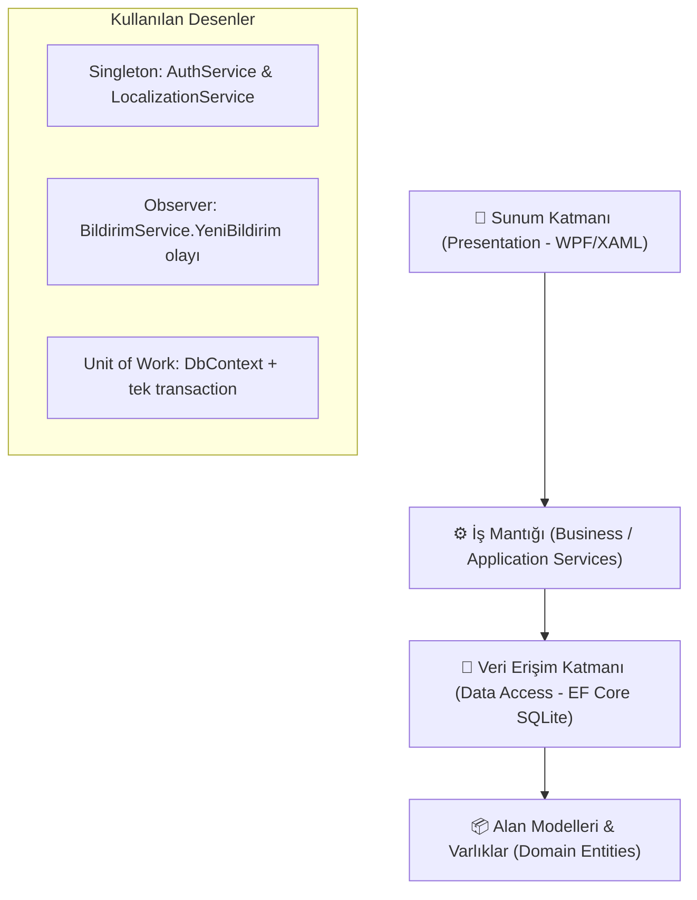

# 🏛️ Kütüphane Yönetim & Akademik Araştırma Sistemi (IRIS Enterprise Suite v3.5)

[](https://dotnet.microsoft.com/)
[](https://en.wikipedia.org/wiki/Multitier_architecture)
[](https://www.sqlite.org/)
[](https://en.wikipedia.org/wiki/Design_Patterns)
[](https://github.com/sudenurozturkk/KutuphaneOtomasyonu)
[]()

**IRIS (Integrated Research & Information System)**, dünya çapındaki araştırma üniversiteleri, enstitüler ve konsorsiyumlar (*Ex Libris Alma / FOLIO standardı*) seviyesinde tasarlanmış, ultra-modernist ve kurumsal masaüstü kütüphane otomasyon sistemidir.

Yazılım Tasarım Mimarisi (Software Architecture) ilkeleri, **Gang of Four (GoF)** desenleri ve temiz kod prensipleri temel alınarak geliştirilmiştir.

---

## 🌟 Öne Çıkan Küresel Yetenekler (World-Class Features)

- 🌐 **Global Çoklu Dil (i18n):** Başlık çubuğundan tek tıkla **İngilizce (EN)** ve **Türkçe (TR)** arayüz geçişi.
- 🎓 **Akademik Tez & Makale Havuzu:** Doktora/Yüksek Lisans tezleri, hakemli dergiler, DOI indeksleri ve açık erişim tam metin indirme.
- 📋 **Otomatik Akademik Alıntı Motoru (Citation Generator):**
  - **APA 7th Edition**
  - **MLA 9th Edition**
  - **BibTeX (LaTeX araştırmacıları için doğrudan kod üretimi)**
- 🚚 **Kampüsler Arası Ödünç Transferi (ILL - Inter-Library Loan):** Merkez, Mühendislik, Tıp ve Sosyal Bilimler kütüphaneleri arasında iç kurye takip kodu (`ILL-2026-TR-...`) ile fiziksel materyal transferi.
- 🪑 **2D İnteraktif Salon Haritası & IoT Telemetrisi:** Sessiz, Bireysel ve Grup alanlarında masa rezervasyonu ve canlı durum rozetleri.
- 💳 **Dijital Cüzdan & RFID Kart:** Otomatik ceza mahsubu, bakiye yükleme ve harcama geçmişi.
- ⚡ **Barkod & ISBN Banko Terminali:** Donanım simülasyonu, anlık log konsolu ve hızlı teslim alma.
- 📊 **Yönetim Analitiği & Raporlama:** Canlı KPI sayaçları, borç analizi ve masaüstüne UTF-8 CSV ihracı.
- 🧩 **Canlı Mimari & UML Müfettişi:** Katman analizi, 5 GoF deseni canlı testi ve garbage collector bellek optimizasyonu.

---

## 🏛️ Mimari Yapı & GoF Tasarım Desenleri

Proje katı **Separation of Concerns (SoC)** ve **Clean Architecture** prensiplerine sadık kalınarak 4 ana katmana ayrılmıştır:



### WPF uygulamasında kullanılan desenler
1. **Singleton (`AuthService`, `LocalizationService`):** Oturum ve dil kaynağının tüm pencerelerde tekil yönetimi.
2. **Observer (`BildirimService.YeniBildirim`):** Bildirim oluşturulduğunda abonelere olay yayını.
3. **Unit of Work (`KutuphaneDbContext` + `VeritabaniIslemi`):** Ödünç, iade, uzatma ve rezervasyon işlemleri; bildirim ve denetim kaydıyla birlikte tek transaction içinde kalıcı olur.

> Not: `KutuphaneOtomasyonuApp/Patterns/` altındaki Factory/Strategy örnekleri ayrı (derlenmeyen) eski WinForms prototipine aittir;
> WPF uygulamasında üye kotaları `UyeService.VarsayilanKota`, ceza hesabı `OduncService.IadeAlAsync` içindedir.

---

## 📋 14 Temel Modül & Yetenek Matrisi

| # | Modül | Açıklama |
|---|---|---|
| 1 | **📊 Genel Bakış (Dashboard)** | Canlı KPI metrikleri, geciken iadeler, salon doluluğu ve hızlı işlem butonları. |
| 2 | **📖 Kitap Kataloğu & Envanter** | Çoklu filtreleme (Kategori, Dil, Stok), ISBN araması ve CSV dışa aktarımı. |
| 3 | **🔄 Ödünç & İade Lojistiği** | Aktif, gecikmiş ve geçmiş işlemler; süre uzatma ve hasar kontrolü. |
| 4 | **👥 Üye Yönetimi** | Öğrenci, Akademisyen ve Personel profilleri, borç durumu ve çift tıkla detay kartı. |
| 5 | **🪑 2D Salon & Masa Haritası** | Sessiz, Bireysel ve Grup alanlarında 20 masa için interaktif rezervasyon ve boşaltma. |
| 6 | **📅 Rezervasyon Kuyruğu** | Tüketen kitaplar için bekleme sırası, sıradan doğrudan ödünce dönüştürme ve iptal. |
| 7 | **⚡ Hızlı Barkod Bankosu** | Barkod/ISBN okutma simülasyonu, canlı terminal log akışı ve hızlı teslimat. |
| 8 | **💳 Akıllı Cüzdan & Üye Kartı** | Bakiye yükleme (₺20, ₺50, ₺100), temassız işlem ve cüzdandan ceza ödeme. |
| 9 | **📱 E-Kitap Okuyucu Hub** | Temiz Kod ve Tasarım Desenleri kitapları, sayfalama, font boyutu ve gece modu. |
| 10 | **📈 Raporlar & Analitik** | Kütüphane metrikleri, aktivite dağılımları ve masaüstüne UTF-8 CSV ihracı. |
| 11 | **⚙️ Sistem Parametreleri** | Ceza tarifeleri, ödünç süre limitleri ve tek tıkla canlı veritabanı yedeği. |
| 12 | **🎓 Akademik Tez & Makale (IRIS)** | Doktora/Y.Lisans tezleri, DOI, açık erişim PDF indirme ve **APA / MLA / BibTeX** alıntı üretici. |
| 13 | **🚚 Kampüs Transferi (ILL)** | 4 üniversite kampüsü arasında kütüphaneler arası kurye ve lojistik takip sistemi. |
| 14 | **🧩 Canlı Mimari & UML (LAB)** | Katman incelemesi, 5 GoF deseni canlı testi ve bellek (GC) optimizasyonu. |

---

## 📂 Proje Dizin Yapısı

```
KutuphaneOtomasyonu/
├── Data/                          # Veritabanı ve Tohumlama
│   ├── KutuphaneDbContext.cs      # EF Core SQLite Bağlantısı & Indexler
│   ├── VeritabaniIslemi.cs        # İç içe çağrılabilen transaction yardımcısı
│   ├── VeritabaniSemasi.cs        # Migration'ları uygular; eski (EnsureCreated) kurulumları tabanlar
│   ├── Migrations/                # EF Core migration'ları (taban, pasaport, KVKK, nüsha, cüzdan)
│   └── DatabaseSeeder.cs          # Demo verisi: 30 Kitap (+ nüshalar), 50 Üye, 5 Akademik Tez
├── Models/                        # Domain Varlıkları
│   ├── Kitap.cs                   # Kitap entity & durum enumları
│   ├── Uye.cs                     # Üye, rol ve borç modelleri
│   ├── Odunc.cs                   # Ödünç hareketleri ve ceza takibi
│   ├── AkademikVeKampus.cs        # Tez, Makale, DOI, Citation, ILL modelleri
│   ├── DigerModeller.cs           # Rezervasyon, Favori, Bildirim modelleri
│   └── KullaniciVeAyarlar.cs      # Admin, Kütüphaneci ve Parametreler
├── Services/                      # İş Mantığı
│   ├── LocalizationService.cs     # [Singleton] Çoklu dil (TR/EN) servisi
│   ├── KitapService.cs            # Katalog: doğrulama, stok güncelleme, arşivleme
│   ├── OduncService.cs            # Ödünç, iade, süre uzatma ve ceza hesabı (transaction içinde)
│   ├── RezervasyonService.cs      # Rezervasyon kuyruğu, ayırma, ödünce dönüştürme
│   ├── BankoAramaService.cs       # Barkod bankosu için belirsizliğe dayanıklı eşleştirme
│   ├── VeritabaniBakimService.cs  # Yedekleme, demo sıfırlama, sistem ayarları (yalnızca Admin)
│   ├── SifreHasher.cs             # PBKDF2-SHA256 parola özetleme
│   ├── DenetimService.cs          # AktiviteLog denetim kayıtları
│   ├── AkademikService.cs         # Tez, DOI, Citation ve ILL lojistiği
│   ├── SalonRezervasyonService.cs # Salon rezervasyon iş kuralları
│   ├── CuzdanService.cs           # Cüzdan hareketleri (yükleme, ceza ödeme)
│   ├── ServisKapsami.cs           # Sayfalar için ortak DbContext + servis kapsamı
│   └── DigerServisler.cs          # AuthService [Singleton], UyeService, BildirimService [Observer]
├── Views/                         # Modernist XAML Arayüzleri
│   ├── LoginWindow.xaml           # Ultra-modern giriş ekranı & Demo butonları
│   ├── MainWindow.xaml            # 260px ferah sidebar menü, TR/EN dil toggle
│   └── Pages/                     # 14 Bağımsız Modül Sayfası & 6 Modal Dialog
│       ├── DashboardPage.xaml     # Yönetici paneli & KPI kartları
│       ├── KitaplarPage.xaml      # Zengin envanter tablosu & filtreler
│       ├── AkademikHubPage.xaml   # Tez arşivi & APA/MLA/BibTeX Citation
│       ├── KampusTransferPage.xaml# ILL Kütüphaneler arası kurye takibi
│       ├── SalonRezervasyonPage.xaml # 2D interaktif masa haritası
│       └── ...                    # Diğer 9 modül ve modal diyaloglar
├── SmokeTester.cs                 # Otomatik Uçtan Uca Doğrulama Motoru
├── Tests/KutuphaneOtomasyonu.Tests/ # İzole SQLite servis testleri (xUnit)
├── docs/
│   ├── uml/                       # Sınıf, nesne, paket ve dağıtım diyagramları
│   ├── engineering-backlog.md     # Bulunan hatalar, kararlar ve doğrulama kanıtları
│   └── kisisel-veri-notlari.md    # KVKK: işlenen veriler ve teknik tedbirler
├── ENGINEERING_LOG.md             # Tarihli geliştirme günlüğü
└── legacy/                        # Derlenmeyen eski WinForms ve web prototipleri (bkz. legacy/README.md)
```

---

## 🚀 Kurulum & Çalıştırma

### Gereksinimler
- [.NET 9.0 SDK](https://dotnet.microsoft.com/download/dotnet/9.0)
- Windows 10 / 11 (x64)

### Başlatma Adımları
```bash
# 1. Depoyu klonlayın
git clone https://github.com/sudenurozturkk/KutuphaneOtomasyonu.git

# 2. Dizin içine girin
cd KutuphaneOtomasyonu

# 3. Bağımlılıkları derleyin ve uygulamayı başlatın
dotnet run
```

### Veritabanı şeması ve migration'lar
Şema EF Core migration'ları ile yönetilir ve uygulama her açılışta bekleyen migration'ları otomatik uygular.
Migration'lardan önceki sürümlerle oluşturulmuş veritabanları ilk açılışta algılanır, veri kaybı olmadan taban
migration'a bağlanır ve yükseltilir (mevcut kitap adetlerinden barkodlu nüshalar üretilir). Yükseltmeden önce
**Sistem Ayarları → Veritabanı Yedeği** ile yedek almanız önerilir.

Geliştiriciler için (araç sürümü `.config/dotnet-tools.json` içinde sabitlenmiştir):
```bash
dotnet tool restore
dotnet ef migrations add <Ad> --output-dir Data/Migrations --namespace KutuphaneOtomasyonu.Data.Migrations
```
Yeni migration eklendiğinde `Tests` içindeki şema yükseltme testleri de çalıştırılmalıdır.

### Varsayılan Giriş Hesapları
| Rol | Kullanıcı Adı | Şifre |
|---|---|---|
| **Sistem Yöneticisi (Admin)** | `admin` | `admin123` |
| **Kütüphaneci (Staff)** | `fatmak` | `123456` |

> ⚠️ Bunlar demo hesaplarıdır. Gerçek bir kurulumda ilk girişten sonra sol menüdeki **Şifre Değiştir** ile
> değiştirilmelidir (en az 8 karakter). Demo bilgileri giriş ekranında yalnızca **Debug** derlemelerinde otomatik doldurulur.
> Parolalar PBKDF2-SHA256 (600.000 iterasyon, kullanıcı başına tuz) ile saklanır; eski sürümün özetleri ilk başarılı girişte
> otomatik yükseltilir. Art arda 5 hatalı denemeden sonra hesap 1 dakika kilitlenir.

### Veri ve günlük konumları
| Öğe | Varsayılan konum |
|---|---|
| Veritabanı | `%APPDATA%\KutuphaneOtomasyonu\kutuphane.db` (`KUTUPHANE_DB_PATH` ortam değişkeni ile değiştirilebilir) |
| Tanılama günlüğü | `%APPDATA%\KutuphaneOtomasyonu\logs\app.log` (1 MB'da döner; parola/kimlik no yazılmaz) |
| Denetim kayıtları | Veritabanında `AktiviteLoglar` tablosu (giriş, ödünç/iade/uzatma, rezervasyon, katalog, üye, ayar, yedek, sıfırlama, dışa aktarma) |

### Yetkilendirme
| İşlem | Gerekli rol |
|---|---|
| Sistem ayarları, veritabanı yedeği, demo verisine sıfırlama, toplu veri dışa aktarımı | Sistem Yöneticisi |
| Diğer tüm modüller | Giriş yapmış personel |

### Dolaşım kuralları (uygulanan)
- Ödünç, iade, uzatma ve rezervasyon işlemleri tek bir SQLite yazma transaction'ı içinde yürür; eşzamanlı iki istek aynı son kopyayı veremez.
- Veritabanı tetikleyicileri `0 <= MevcutAdet <= ToplamAdet` kuralını korur; bir üyenin aynı kitap için yalnızca bir aktif ödüncü olabilir.
- Arşivlenmiş kitap ödünç verilemez/rezerve edilemez; ödünçte kopyası olan kitap arşivlenemez.
- Üyelik bitiş tarihi geçmiş, aktif olmayan, borcu olan veya kotasını doldurmuş üyeye ödünç verilmez.
- İade edilen kopya, sıradaki geçerli rezervasyon sahibine `RezervasyonGecerlilikSuresi` gün boyunca ayrılır; bu sürede başkasına verilemez.
- Her fiziksel kopya bir **nüsha** kaydıdır ve benzersiz barkod taşır (`KB` + 6 hane kitap no + 4 hane sıra, ör. `KB0000120003`).
  Ödünç kaydı hangi nüshanın verildiğini tutar; bir nüsha aynı anda yalnızca bir aktif ödünçte olabilir.
  `ToplamAdet` = rafta + ödünçteki nüsha, `MevcutAdet` = raftaki nüsha sayısıdır. Nüshalar kitap detayında listelenir.
- Barkod bankosunda nüsha barkodu okutulursa tam o kopya verilir; iadede nüsha barkodu tek başına yeterlidir.
  ISBN veya başlıkla yapılan iadede aynı kitaptan birden çok kopya ödünçteyse üye bilgisi istenir.
- `Hasarli` ve `Kayip` iadelerde nüsha dolaşımdan çıkarılır (`ToplamAdet` azalır) ve ceza kaydı oluşturulur.
  Onarılan kopya, kitap düzenleme ekranından toplam adet artırılarak yeniden eklenir.
- Toplam adet azaltılırsa en son eklenen raftaki nüshalar "envanterden çıkarıldı" olarak işaretlenir (kayıt silinmez).
- Süre uzatma, sistemdeki "Maksimum Ödünç Süresi" kadar yapılır; gecikmiş ödünç uzatılamaz; uzatma hakkı ayarlardan alınır.
  Başka bir üye kitabı bekliyorsa ve ona verilebilecek boş kopya yoksa uzatma yapılmaz.

### Üyeler ve kişisel veriler
- Türk vatandaşları için T.C. Kimlik No, yabancılar için Yabancı Kimlik No (aynı algoritma) veya **Pasaport No** girilir; en az biri zorunludur.
- Yardımcı personel kimlik, pasaport ve telefon bilgilerini maskeli görür ve üye kimlik bilgilerini düzenleyemez.
- Yönetici, KVKK silme talepleri için üyeyi **anonimleştirebilir**. Ayrıntılar: [`docs/kisisel-veri-notlari.md`](docs/kisisel-veri-notlari.md).

### Cüzdan
- Cüzdan bakiyesi kalıcı bir hareket defterinden hesaplanır (`CuzdanHareketleri`). Bakiye yükleme, bankoda tahsil edilen
  tutarın kaydıdır (ödeme sağlayıcısı entegrasyonu yoktur). Ceza borcu bakiyeden tek seferde tahsil edilir; her hareket denetlenir.

### Parola politikası
- Release derlemelerinde varsayılan (`admin123`, `123456`) veya 8 karakterden kısa parolayla giriş yapan kullanıcı,
  ana ekrana geçmeden önce parolasını değiştirmek zorundadır. Debug (demo) derlemelerinde bu adım atlanır.

---

## 🧪 Otomatik Test ve Sağlamlık Doğrulaması

Proje, 14 modülün, 6 modal pencerenin ve tüm menü geçişlerinin UI seviyesinde hatasız çalıştığını test eden yerleşik bir test motoruna sahiptir:

```bash
# Otomatik doğrulamayı çalıştırın:
dotnet run -- --test
```

`--test` modu kullanıcının veritabanına dokunmaz: geçici bir veritabanı oluşturur, gerçek bir ödünç/iade turu dahil
kontrolleri çalıştırır, sonucu `test_result.txt` dosyasına yazar ve herhangi bir `[FAIL]` olursa sıfırdan farklı çıkış kodu döner.

Servis katmanını WPF başlatmadan, izole SQLite veritabanlarında test etmek için:

```bash
dotnet test .\Tests\KutuphaneOtomasyonu.Tests\KutuphaneOtomasyonu.Tests.csproj
```

Testler uygulamanın gerçek şema hazırlığını (tetikleyiciler ve indeksler dahil) kullanır ve şunları kapsar:
ödünç/iade/uzatma kuralları ve stok değişmezi, gecikme/hasar/kayıp cezaları, rezervasyon kuyruğu ve ayırma,
dosya tabanlı veritabanında **eşzamanlı ödünç istekleri**, ISBN/TC Kimlik/e-posta doğrulama, katalog ve üye servisleri,
PBKDF2 parola özetleme ve eski özetlerin yükseltilmesi, hatalı giriş kilidi, yönetici yetki kontrolleri,
çevrimiçi yedekleme ve demo sıfırlama, eski veritabanlarının şema yükseltmesi, CSV kaçışı, barkod eşleştirme ve salon rezervasyonları.

**Konsol Çıktısı:**
```
=== GENİŞLETİLMİŞ TÜM MODÜLLER TESTİ ===
[PASS] Veritabanı bağlantısı ve Seed (30 kitap, 5 akademik tez, 50 üye, 14 ödünç)
[PASS] Admin girişi başarılı: Ahmet Yıldız
--- 14 SAYFANIN TESTİ ---
[PASS] 1. DashboardPage oluşturuldu
[PASS] 2. KitaplarPage oluşturuldu
[PASS] 3. OdunclerPage oluşturuldu
[PASS] 4. UyelerPage oluşturuldu
[PASS] 5. SalonRezervasyonPage oluşturuldu
[PASS] 6. RezervasyonlarPage oluşturuldu
[PASS] 7. BarkodBankoPage oluşturuldu
[PASS] 8. CuzdanPage oluşturuldu
[PASS] 9. EKitapPage oluşturuldu
[PASS] 10. RaporlarPage oluşturuldu
[PASS] 11. AyarlarPage oluşturuldu
[PASS] 12. MimariUmlPage oluşturuldu
[PASS] 13. AkademikHubPage oluşturuldu
[PASS] 14. KampusTransferPage oluşturuldu
--- 6 DİYALOG PENCERESİNİN TESTİ ---
[PASS] KitapEkleDialog, UyeEkleDialog, OduncVerDialog, IadeDialog, KitapDetayDialog, UyeDetayDialog
--- MENÜ NAVİGASYONLARI TESTİ ---
[PASS] MainWindow 14 sayfa rotasının tümü %100 BAŞARILI.
```

---

## 📚 Dokümanlar

| Dosya | İçerik |
|---|---|
| [`docs/uml/`](docs/uml/README.md) | UML: sınıf, nesne, paket ve dağıtım diyagramları (açıklamalı) |
| [`docs/kisisel-veri-notlari.md`](docs/kisisel-veri-notlari.md) | KVKK: hangi kişisel veri, hangi amaçla, hangi tedbirlerle işleniyor; kurumun karar vermesi gerekenler |
| [`docs/engineering-backlog.md`](docs/engineering-backlog.md) | Bulunan hatalar (P0/P1/P2), verilen tasarım kararları (D-01…D-09) ve her birinin test kanıtı |
| [`ENGINEERING_LOG.md`](ENGINEERING_LOG.md) | Tarih sırasıyla yapılan geliştirme çalışmaları ve doğrulama sonuçları |
| [`legacy/README.md`](legacy/README.md) | Eski prototiplerin ne olduğu ve nasıl açılacağı |

---

## 📄 Lisans
Bu proje MIT Lisansı altında açık kaynaklı olarak sunulmaktadır. Üniversiteler, araştırma enstitüleri ve eğitim kurumları serbestçe genişletebilir ve kullanabilir.
