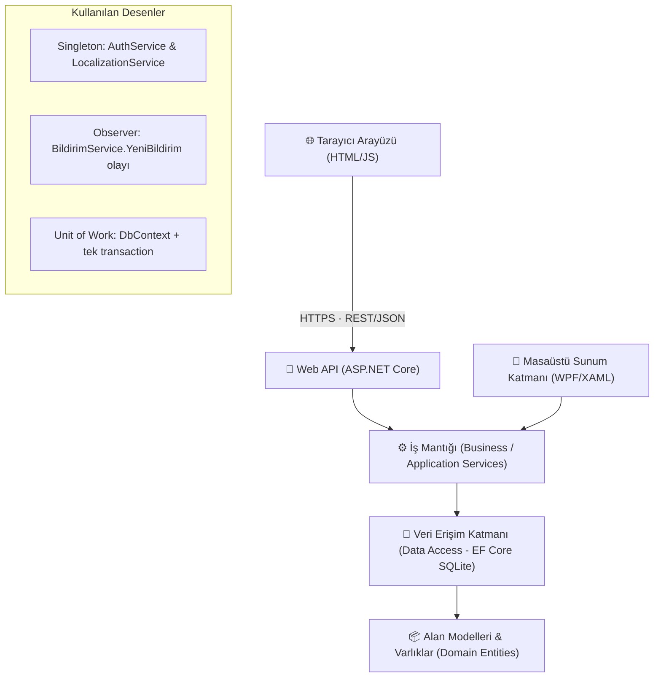

# 🏛️ Kütüphane Yönetim & Akademik Araştırma Sistemi (IRIS Enterprise Suite v3.5)

[](https://dotnet.microsoft.com/)
[](https://en.wikipedia.org/wiki/Multitier_architecture)
[](https://www.sqlite.org/)
[](https://en.wikipedia.org/wiki/Design_Patterns)
[](https://github.com/sudenurozturkk/KutuphaneOtomasyonu)
[]()

**IRIS (Integrated Research & Information System)**, dünya çapındaki araştırma üniversiteleri, enstitüler ve konsorsiyumlar (*Ex Libris Alma / FOLIO standardı*) seviyesinde tasarlanmış, ultra-modernist ve kurumsal **çevrimiçi kütüphane yönetim sistemidir**: personel ve öğrenciler
tarayıcıdan **ASP.NET Core Web API** üzerinden, banko personeli ise isterse WPF masaüstü uygulamasıyla çalışır. İki istemci
de aynı iş kuralları kütüphanesini (`KutuphaneOtomasyonu.Core`) ve aynı veritabanını kullanır.

Yazılım Tasarım Mimarisi (Software Architecture) ilkeleri, **Gang of Four (GoF)** desenleri ve temiz kod prensipleri temel alınarak geliştirilmiştir.

---

## 🌟 Öne Çıkan Küresel Yetenekler (World-Class Features)

- 🌐 **Global Çoklu Dil (i18n):** Başlık çubuğundan tek tıkla **İngilizce (EN)** ve **Türkçe (TR)** arayüz geçişi.
- 🎓 **Akademik Tez & Makale Havuzu:** Doktora/Yüksek Lisans tezleri, hakemli dergiler, DOI indeksleri ve açık erişim tam metin indirme.
- 📋 **Otomatik Akademik Alıntı Motoru (Citation Generator):**
  - **APA 7th Edition**
  - **MLA 9th Edition**
  - **BibTeX (LaTeX araştırmacıları için doğrudan kod üretimi)**
- 🚚 **Kampüsler Arası Ödünç Transferi (ILL - Inter-Library Loan):** Merkez, Mühendislik, Tıp ve Sosyal Bilimler kütüphaneleri arasında iç kurye takip kodu (`ILL-2026-TR-...`) ile fiziksel materyal transferi.
- 🪑 **2D İnteraktif Salon Haritası & IoT Telemetrisi:** Sessiz, Bireysel ve Grup alanlarında masa rezervasyonu ve canlı durum rozetleri.
- 💳 **Dijital Cüzdan & RFID Kart:** Otomatik ceza mahsubu, bakiye yükleme ve harcama geçmişi.
- ⚡ **Barkod & ISBN Banko Terminali:** Donanım simülasyonu, anlık log konsolu ve hızlı teslim alma.
- 📊 **Yönetim Analitiği & Raporlama:** Canlı KPI sayaçları, borç analizi ve masaüstüne UTF-8 CSV ihracı.
- 🧩 **Canlı Mimari & UML Müfettişi:** Katman analizi, 5 GoF deseni canlı testi ve garbage collector bellek optimizasyonu.

---

## 🏛️ Mimari Yapı & GoF Tasarım Desenleri

Proje katı **Separation of Concerns (SoC)** prensibiyle katmanlara ayrılmıştır. İş mantığı, veri erişimi ve alan modelleri
arayüzden bağımsız `KutuphaneOtomasyonu.Core` kütüphanesindedir; Web API ve WPF bu kütüphanenin iki ayrı istemcisidir:



### WPF uygulamasında kullanılan desenler
1. **Singleton (`AuthService`, `LocalizationService`):** Oturum ve dil kaynağının tüm pencerelerde tekil yönetimi.
2. **Observer (`BildirimService.YeniBildirim`):** Bildirim oluşturulduğunda abonelere olay yayını.
3. **Unit of Work (`KutuphaneDbContext` + `VeritabaniIslemi`):** Ödünç, iade, uzatma ve rezervasyon işlemleri; bildirim ve denetim kaydıyla birlikte tek transaction içinde kalıcı olur.

> Not: `legacy/WinFormsPrototype/Patterns/` altındaki Factory/Strategy örnekleri ayrı (derlenmeyen) eski WinForms prototipine aittir;
> WPF uygulamasında üye kotaları `UyeService.VarsayilanKota`, ceza hesabı `OduncService.IadeAlAsync` içindedir.

---

## 📋 14 Temel Modül & Yetenek Matrisi

| # | Modül | Açıklama |
|---|---|---|
| 1 | **📊 Genel Bakış (Dashboard)** | Canlı KPI metrikleri, geciken iadeler, salon doluluğu ve hızlı işlem butonları. |
| 2 | **📖 Kitap Kataloğu & Envanter** | Çoklu filtreleme (Kategori, Dil, Stok), ISBN araması ve CSV dışa aktarımı. |
| 3 | **🔄 Ödünç & İade Lojistiği** | Aktif, gecikmiş ve geçmiş işlemler; süre uzatma ve hasar kontrolü. |
| 4 | **👥 Üye Yönetimi** | Öğrenci, Akademisyen ve Personel profilleri, borç durumu ve çift tıkla detay kartı. |
| 5 | **🪑 2D Salon & Masa Haritası** | Sessiz, Bireysel ve Grup alanlarında 20 masa için interaktif rezervasyon ve boşaltma. |
| 6 | **📅 Rezervasyon Kuyruğu** | Tüketen kitaplar için bekleme sırası, sıradan doğrudan ödünce dönüştürme ve iptal. |
| 7 | **⚡ Hızlı Barkod Bankosu** | Barkod/ISBN okutma simülasyonu, canlı terminal log akışı ve hızlı teslimat. |
| 8 | **💳 Akıllı Cüzdan & Üye Kartı** | Bakiye yükleme (₺20, ₺50, ₺100), temassız işlem ve cüzdandan ceza ödeme. |
| 9 | **📱 E-Kitap Okuyucu Hub** | Temiz Kod ve Tasarım Desenleri kitapları, sayfalama, font boyutu ve gece modu. |
| 10 | **📈 Raporlar & Analitik** | Kütüphane metrikleri, aktivite dağılımları ve masaüstüne UTF-8 CSV ihracı. |
| 11 | **⚙️ Sistem Parametreleri** | Ceza tarifeleri, ödünç süre limitleri ve tek tıkla canlı veritabanı yedeği. |
| 12 | **🎓 Akademik Tez & Makale (IRIS)** | Doktora/Y.Lisans tezleri, DOI, açık erişim PDF indirme ve **APA / MLA / BibTeX** alıntı üretici. |
| 13 | **🚚 Kampüs Transferi (ILL)** | 4 üniversite kampüsü arasında kütüphaneler arası kurye ve lojistik takip sistemi. |
| 14 | **🧩 Canlı Mimari & UML (LAB)** | Katman incelemesi, 5 GoF deseni canlı testi ve bellek (GC) optimizasyonu. |

---

## 📂 Proje Dizin Yapısı

```
KutuphaneOtomasyonu/
├── src/
│   ├── KutuphaneOtomasyonu.Core/      # Arayüzden bağımsız çekirdek (net9.0 sınıf kütüphanesi)
│   │   ├── Models/                    # Alan varlıkları: Kitap, KitapNushasi, Uye, Odunc, Rezervasyon, Kullanici …
│   │   ├── Data/                      # KutuphaneDbContext, Migrations/, VeritabaniSemasi, DatabaseSeeder (demo verisi)
│   │   └── Services/                  # İş kuralları: OduncService, KitapService, UyeService, RezervasyonService,
│   │                                  #   KimlikDogrulamaService, BankoAramaService, DenetimService, SifreHasher …
│   └── KutuphaneOtomasyonu.Api/       # ASP.NET Core Web API (çevrimiçi sistem)
│       ├── Program.cs                 # Veritabanı, oturum, hız sınırı, OpenAPI, statik dosyalar
│       ├── Altyapi/                   # Çerez oturumu ve rol politikaları, hata yanıtları, güvenlik başlıkları
│       ├── Endpoints/                 # Katalog, Oturum, Üyeler, Ödünç, Rezervasyon + Pano uç noktaları
│       ├── Dto/                       # API'nin döndürdüğü/aldığı veri modelleri
│       └── wwwroot/                   # Tarayıcı arayüzü (index.html, app.js, app.css)
├── Views/                             # WPF masaüstü arayüzü (pencereler, 14 sayfa, diyaloglar)
├── App.xaml(.cs), SmokeTester.cs      # Masaüstü uygulaması girişi ve --test duman testi
├── KutuphaneOtomasyonu.csproj         # WPF masaüstü uygulaması (Core'a referans verir)
├── Tests/
│   ├── KutuphaneOtomasyonu.Tests/     # Servis katmanı testleri (izole SQLite, xUnit)
│   └── KutuphaneOtomasyonu.Api.Tests/ # Web API entegrasyon testleri (WebApplicationFactory)
├── docs/
│   ├── uml/                           # Sınıf, nesne, paket ve dağıtım diyagramları
│   ├── engineering-backlog.md         # Bulunan hatalar, kararlar ve doğrulama kanıtları
│   └── kisisel-veri-notlari.md        # KVKK: işlenen veriler ve teknik tedbirler
├── ENGINEERING_LOG.md                 # Tarihli geliştirme günlüğü
└── legacy/                            # Derlenmeyen eski WinForms ve web prototipleri (bkz. legacy/README.md)
```

---

## 🚀 Kurulum & Çalıştırma

### Gereksinimler
- [.NET 9.0 SDK](https://dotnet.microsoft.com/download/dotnet/9.0)
- Web API: Windows, Linux veya macOS · WPF masaüstü uygulaması: Windows 10 / 11 (x64)

### Başlatma Adımları
```bash
# 1. Depoyu klonlayın
git clone https://github.com/sudenurozturkk/KutuphaneOtomasyonu.git

# 2. Dizin içine girin
cd KutuphaneOtomasyonu

# 3a. Çevrimiçi sistem: Web API + tarayıcı arayüzü → https://localhost:7215
dotnet run --project src/KutuphaneOtomasyonu.Api --launch-profile https

# 3b. Masaüstü (WPF) uygulaması (yalnızca Windows)
dotnet run
```

### Veritabanı şeması ve migration'lar
Şema EF Core migration'ları ile yönetilir ve uygulama her açılışta bekleyen migration'ları otomatik uygular.
Migration'lardan önceki sürümlerle oluşturulmuş veritabanları ilk açılışta algılanır, veri kaybı olmadan taban
migration'a bağlanır ve yükseltilir (mevcut kitap adetlerinden barkodlu nüshalar üretilir). Yükseltmeden önce
**Sistem Ayarları → Veritabanı Yedeği** ile yedek almanız önerilir.

Geliştiriciler için (araç sürümü `.config/dotnet-tools.json` içinde sabitlenmiştir):
```bash
dotnet tool restore
dotnet ef migrations add <Ad> --project src/KutuphaneOtomasyonu.Core --startup-project src/KutuphaneOtomasyonu.Core \
  --output-dir Data/Migrations --namespace KutuphaneOtomasyonu.Data.Migrations
```
Yeni migration eklendiğinde `Tests` içindeki şema yükseltme testleri de çalıştırılmalıdır.

### Varsayılan Giriş Hesapları
| Rol | Kullanıcı Adı | Şifre |
|---|---|---|
| **Sistem Yöneticisi (Admin)** | `admin` | `admin123` |
| **Kütüphaneci (Staff)** | `fatmak` | `123456` |
| **Öğrenci (web portalı)** | `2026000001` veya `ogrenci@demo.edu.tr` | `ogrenci123` |

> ⚠️ Bunlar demo hesaplarıdır. Gerçek bir kurulumda ilk girişten sonra sol menüdeki **Şifre Değiştir** ile
> değiştirilmelidir (en az 8 karakter). Demo bilgileri giriş ekranında yalnızca **Debug** derlemelerinde otomatik doldurulur.
> Parolalar PBKDF2-SHA256 (600.000 iterasyon, kullanıcı başına tuz) ile saklanır; eski sürümün özetleri ilk başarılı girişte
> otomatik yükseltilir. Art arda 5 hatalı denemeden sonra hesap 1 dakika kilitlenir.

### Veri ve günlük konumları
| Öğe | Varsayılan konum |
|---|---|
| Veritabanı | `%APPDATA%\KutuphaneOtomasyonu\kutuphane.db` (`KUTUPHANE_DB_PATH` ortam değişkeni ile değiştirilebilir) |
| Tanılama günlüğü | `%APPDATA%\KutuphaneOtomasyonu\logs\app.log` (1 MB'da döner; parola/kimlik no yazılmaz) |
| Denetim kayıtları | Veritabanında `AktiviteLoglar` tablosu (giriş, ödünç/iade/uzatma, rezervasyon, katalog, üye, ayar, yedek, sıfırlama, dışa aktarma) |

### Yetkilendirme
| İşlem | Gerekli rol |
|---|---|
| Sistem ayarları, veritabanı yedeği, demo verisine sıfırlama, toplu veri dışa aktarımı | Sistem Yöneticisi |
| Diğer tüm modüller | Giriş yapmış personel |

### Dolaşım kuralları (uygulanan)
- Ödünç, iade, uzatma ve rezervasyon işlemleri tek bir SQLite yazma transaction'ı içinde yürür; eşzamanlı iki istek aynı son kopyayı veremez.
- Veritabanı tetikleyicileri `0 <= MevcutAdet <= ToplamAdet` kuralını korur; bir üyenin aynı kitap için yalnızca bir aktif ödüncü olabilir.
- Arşivlenmiş kitap ödünç verilemez/rezerve edilemez; ödünçte kopyası olan kitap arşivlenemez.
- Üyelik bitiş tarihi geçmiş, aktif olmayan, borcu olan veya kotasını doldurmuş üyeye ödünç verilmez.
- İade edilen kopya, sıradaki geçerli rezervasyon sahibine `RezervasyonGecerlilikSuresi` gün boyunca ayrılır; bu sürede başkasına verilemez.
- Her fiziksel kopya bir **nüsha** kaydıdır ve benzersiz barkod taşır (`KB` + 6 hane kitap no + 4 hane sıra, ör. `KB0000120003`).
  Ödünç kaydı hangi nüshanın verildiğini tutar; bir nüsha aynı anda yalnızca bir aktif ödünçte olabilir.
  `ToplamAdet` = rafta + ödünçteki nüsha, `MevcutAdet` = raftaki nüsha sayısıdır. Nüshalar kitap detayında listelenir.
- Barkod bankosunda nüsha barkodu okutulursa tam o kopya verilir; iadede nüsha barkodu tek başına yeterlidir.
  ISBN veya başlıkla yapılan iadede aynı kitaptan birden çok kopya ödünçteyse üye bilgisi istenir.
- `Hasarli` ve `Kayip` iadelerde nüsha dolaşımdan çıkarılır (`ToplamAdet` azalır) ve ceza kaydı oluşturulur.
  Onarılan kopya, kitap düzenleme ekranından toplam adet artırılarak yeniden eklenir.
- Toplam adet azaltılırsa en son eklenen raftaki nüshalar "envanterden çıkarıldı" olarak işaretlenir (kayıt silinmez).
- Süre uzatma, sistemdeki "Maksimum Ödünç Süresi" kadar yapılır; gecikmiş ödünç uzatılamaz; uzatma hakkı ayarlardan alınır.
  Başka bir üye kitabı bekliyorsa ve ona verilebilecek boş kopya yoksa uzatma yapılmaz.

### Üyeler ve kişisel veriler
- Türk vatandaşları için T.C. Kimlik No, yabancılar için Yabancı Kimlik No (aynı algoritma) veya **Pasaport No** girilir; en az biri zorunludur.
- Yardımcı personel kimlik, pasaport ve telefon bilgilerini maskeli görür ve üye kimlik bilgilerini düzenleyemez.
- Yönetici, KVKK silme talepleri için üyeyi **anonimleştirebilir**. Ayrıntılar: [`docs/kisisel-veri-notlari.md`](docs/kisisel-veri-notlari.md).

### Cüzdan
- Cüzdan bakiyesi kalıcı bir hareket defterinden hesaplanır (`CuzdanHareketleri`). Bakiye yükleme, bankoda tahsil edilen
  tutarın kaydıdır (ödeme sağlayıcısı entegrasyonu yoktur). Ceza borcu bakiyeden tek seferde tahsil edilir; her hareket denetlenir.

### Parola politikası
- Release derlemelerinde varsayılan (`admin123`, `123456`) veya 8 karakterden kısa parolayla giriş yapan kullanıcı,
  ana ekrana geçmeden önce parolasını değiştirmek zorundadır. Debug (demo) derlemelerinde bu adım atlanır.

---

## 🌐 Çevrimiçi Kullanım: Web API ve Tarayıcı Arayüzü

Sistem yalnızca masaüstünde değil, **ağ üzerinden de** çalışır. `src/KutuphaneOtomasyonu.Api` projesi aynı iş kurallarını
(`KutuphaneOtomasyonu.Core`) bir **ASP.NET Core Web API** olarak sunar ve tarayıcı arayüzünü (`wwwroot`) barındırır:

- **Herkes (giriş gerekmez):** katalogda arama, kategori süzme, kitabın nüshalarının rafta/ödünçte durumu.
- **Öğrenci (giriş ile, "Hesabım"):** ödünçteki kitaplar ve kalan gün, süre uzatma, kitap rezervasyonu ve iptali,
  borç, bildirimler, geçmiş ödünçler, şifre değiştirme. Öğrenci yalnızca kendi kayıtlarını görür.
- **Personel (giriş ile):** pano, barkod bankosu (nüsha barkodu + üye ile ödünç, barkodla iade), ödünç listesi
  (uzatma/iade), üyeler, rezervasyonlar, kitap ve üye ekleme.

```bash
# Web API + tarayıcı arayüzünü başlatın (geliştirme ortamı, demo verisi ile)
dotnet run --project src/KutuphaneOtomasyonu.Api --launch-profile https
```

| Adres | İçerik |
|---|---|
| `https://localhost:7215/` | Tarayıcı arayüzü (katalog ve personel paneli) |
| `https://localhost:7215/swagger` | Swagger: tüm uç noktaları deneme arayüzü (yalnızca geliştirme ortamında) |
| `https://localhost:7215/openapi/v1.json` | OpenAPI belgesi |

Aynı ağdaki başka cihazlardan erişmek için sunucuyu `--urls "https://0.0.0.0:7215"` ile başlatıp güvenlik duvarında
portu açın. Personel girişinde masaüstü uygulamasıyla aynı hesaplar kullanılır (`admin` / `admin123`, `fatmak` / `123456`).
Demo öğrenci: `2026000001` / `ogrenci123`.

**Öğrenci hesabı nasıl açılır?** Kütüphaneci, üye detayında (web panelinde veya masaüstünde) **"Portal hesabı aç"** der;
sistem 10 karakterlik **geçici şifre** üretir ve bir kez gösterir. Öğrenci öğrenci numarası (veya e-postası) ve bu şifreyle
girer, devam etmeden önce kendi şifresini belirlemek zorundadır. "Şifremi unuttum" durumunda aynı düğme şifreyi sıfırlar
ve öğrencinin açık oturumlarını kapatır.

### Uç noktalar

| Yöntem ve yol | Yetki | Açıklama |
|---|---|---|
| `GET /api/katalog`, `GET /api/katalog/{id}`, `GET /api/katalog/kategoriler` | Herkes | Arama (sayfalı), kitap ve nüsha durumu |
| `POST /api/oturum/giris`, `POST /api/oturum/cikis`, `GET /api/oturum/ben`, `POST /api/oturum/sifre` | — / Oturum | Giriş, çıkış, oturum bilgisi, parola değişimi |
| `GET /api/pano` | Personel | Özet sayılar ve iade tarihi yaklaşan ödünçler |
| `GET /api/oduncler` · `POST /api/oduncler` | Personel | Aktif/gecikmiş/üye geçmişi · nüsha barkodu veya kitap + üye ile ödünç |
| `POST /api/oduncler/{id}/iade` · `POST /api/oduncler/iade-barkod` · `POST /api/oduncler/{id}/uzat` | Personel | İade (durum: İyi/Hasarlı/Kayıp…) ve süre uzatma |
| `GET /api/uyeler`, `GET /api/uyeler/{id}` | Personel | Arama ve detay (Yardımcı Personel'e kimlik/telefon maskeli) |
| `POST /api/uyeler`, `PUT /api/uyeler/{id}`, `POST /api/uyeler/{id}/ceza-ode` | Kütüphaneci | Üye kaydı, güncelleme, ceza tahsilatı |
| `POST /api/kitaplar`, `PUT /api/kitaplar/{id}`, `DELETE /api/kitaplar/{id}` | Kütüphaneci | Kitap ekleme, güncelleme, arşivleme |
| `GET/POST /api/rezervasyonlar`, `POST …/{id}/iptal`, `POST …/{id}/odunce-donustur` | Personel | Bekleme sırası |
| `POST /api/uyeler/{id}/portal-sifresi` | Kütüphaneci | Öğrenci portalı için tek seferlik geçici şifre |
| `POST /api/uye-oturum/giris`, `…/cikis`, `GET …/ben`, `POST …/sifre` | — / Öğrenci | Öğrenci girişi (öğrenci no veya e-posta), çıkış, şifre |
| `GET /api/hesabim`, `GET …/oduncler`, `POST …/oduncler/{id}/uzat` | Öğrenci | Kendi özeti, ödünçleri, süre uzatma |
| `GET/POST /api/hesabim/rezervasyonlar`, `POST …/{id}/iptal`, `GET …/bildirimler`, `POST …/bildirimler/{id}/okundu` | Öğrenci | Kendi rezervasyonları ve bildirimleri |

Hatalar [RFC 9457 Problem Details](https://www.rfc-editor.org/rfc/rfc9457) biçiminde döner; kullanıcıya gösterilecek
mesaj `detail` alanındadır. Enum değerleri metin olarak gelir (`"Aktif"`, `"Rafta"` …).

### Ayarlar (`appsettings.json` veya ortam değişkenleri)

| Anahtar | Varsayılan | Açıklama |
|---|---|---|
| `Veritabani:Yol` | boş → `%APPDATA%\KutuphaneOtomasyonu\kutuphane.db` | Boş bırakılırsa masaüstü uygulamasıyla **aynı veritabanı** kullanılır. Ortam değişkeni: `Veritabani__Yol` |
| `Veritabani:DemoVerisi` | `false` (geliştirmede `true`) | Boş veritabanına demo verisi yükler |
| `Guvenlik:VarsayilanSifreDegisimiZorunlu` | `true` (geliştirmede `false`) | Varsayılan/kısa parolayla giren personel, parolasını değiştirene kadar işlem yapamaz |

### Web güvenliği
- Personel ve öğrenci oturumları **ayrı çerezlerdir**; öğrenci çerezi personel uç noktalarına, personel çerezi `/api/hesabim`
  uç noktalarına erişim sağlamaz. Öğrencinin kimliği istekten değil oturumdan alınır; başka üyenin kaydı `404` döner.
- Öğrenci şifresi değişince veya sıfırlanınca eski oturumları geçersiz olur (oturumda şifreye bağlı damga tutulur);
  yasaklanan veya anonimleştirilen öğrencinin oturumu hemen düşer.
- Oturum çerezi `HttpOnly`, `SameSite=Strict` ve üretimde `Secure`; 8 saat, kayan süre. Her istekte personelin hâlâ
  aktif olduğu ve rolünün değişmediği veritabanından denetlenir.
- Giriş: hesap başına 5 hatalı denemede 1 dakika kilit + IP başına dakikada 10 deneme sınırı (`429`).
- Yanıtlar veritabanı varlıklarını değil, ayrı veri modellerini (DTO) döndürür; parola özeti veya gereksiz kişisel veri dışarı çıkmaz.
- Tarayıcı arayüzünde kullanıcı verisi yalnızca metin olarak yazılır; `Content-Security-Policy` satır içi betiğe izin vermez,
  `X-Frame-Options: DENY`, `nosniff`, üretimde HSTS ve HTTPS yönlendirmesi açıktır.

---

## 🧪 Otomatik Test ve Sağlamlık Doğrulaması

Proje, 14 modülün, 6 modal pencerenin ve tüm menü geçişlerinin UI seviyesinde hatasız çalıştığını test eden yerleşik bir test motoruna sahiptir:

```bash
# Otomatik doğrulamayı çalıştırın:
dotnet run -- --test
```

`--test` modu kullanıcının veritabanına dokunmaz: geçici bir veritabanı oluşturur, gerçek bir ödünç/iade turu dahil
kontrolleri çalıştırır, sonucu `test_result.txt` dosyasına yazar ve herhangi bir `[FAIL]` olursa sıfırdan farklı çıkış kodu döner.

Servis katmanını WPF başlatmadan, izole SQLite veritabanlarında test etmek için:

```bash
dotnet test .\Tests\KutuphaneOtomasyonu.Tests\KutuphaneOtomasyonu.Tests.csproj
```

Web API'yi gerçek HTTP istekleriyle (geçici veritabanı, üretim ayarları) test etmek için:

```bash
dotnet test .\Tests\KutuphaneOtomasyonu.Api.Tests\KutuphaneOtomasyonu.Api.Tests.csproj
```

API testleri; anonim katalog erişimini, oturumsuz isteklerin `401` almasını, çerez güvenlik özelliklerini, hesap kilidini,
pasifleştirilen personelin oturumunun düşmesini, barkodla ödünç/iade turunu ve denetim kaydını, **eşzamanlı isteklerde son
nüshanın yalnızca bir kez verilmesini**, rol bazlı maskeleme ve `403` yanıtlarını, zorunlu parola değişimini ve güvenlik
başlıklarını doğrular. Öğrenci portalı testleri; öğrenci ve personel oturumlarının birbirinin uç noktalarına erişememesini,
öğrencinin yalnızca kendi ödünç/rezervasyon kayıtlarını görüp değiştirebilmesini, geçici şifrenin değiştirilmeden işlem
yapılamamasını ve şifre sıfırlanınca/üye yasaklanınca oturumun düşmesini doğrular.

Testler uygulamanın gerçek şema hazırlığını (tetikleyiciler ve indeksler dahil) kullanır ve şunları kapsar:
ödünç/iade/uzatma kuralları ve stok değişmezi, gecikme/hasar/kayıp cezaları, rezervasyon kuyruğu ve ayırma,
dosya tabanlı veritabanında **eşzamanlı ödünç istekleri**, ISBN/TC Kimlik/e-posta doğrulama, katalog ve üye servisleri,
PBKDF2 parola özetleme ve eski özetlerin yükseltilmesi, hatalı giriş kilidi, yönetici yetki kontrolleri,
çevrimiçi yedekleme ve demo sıfırlama, eski veritabanlarının şema yükseltmesi, CSV kaçışı, barkod eşleştirme ve salon rezervasyonları.

**Konsol Çıktısı:**
```
=== GENİŞLETİLMİŞ TÜM MODÜLLER TESTİ ===
[PASS] Veritabanı bağlantısı ve Seed (30 kitap, 5 akademik tez, 50 üye, 14 ödünç)
[PASS] Admin girişi başarılı: Ahmet Yıldız
--- 14 SAYFANIN TESTİ ---
[PASS] 1. DashboardPage oluşturuldu
[PASS] 2. KitaplarPage oluşturuldu
[PASS] 3. OdunclerPage oluşturuldu
[PASS] 4. UyelerPage oluşturuldu
[PASS] 5. SalonRezervasyonPage oluşturuldu
[PASS] 6. RezervasyonlarPage oluşturuldu
[PASS] 7. BarkodBankoPage oluşturuldu
[PASS] 8. CuzdanPage oluşturuldu
[PASS] 9. EKitapPage oluşturuldu
[PASS] 10. RaporlarPage oluşturuldu
[PASS] 11. AyarlarPage oluşturuldu
[PASS] 12. MimariUmlPage oluşturuldu
[PASS] 13. AkademikHubPage oluşturuldu
[PASS] 14. KampusTransferPage oluşturuldu
--- 6 DİYALOG PENCERESİNİN TESTİ ---
[PASS] KitapEkleDialog, UyeEkleDialog, OduncVerDialog, IadeDialog, KitapDetayDialog, UyeDetayDialog
--- MENÜ NAVİGASYONLARI TESTİ ---
[PASS] MainWindow 14 sayfa rotasının tümü %100 BAŞARILI.
```

---

## 📚 Dokümanlar

| Dosya | İçerik |
|---|---|
| [`docs/uml/`](docs/uml/README.md) | UML: sınıf, nesne, paket ve dağıtım diyagramları (açıklamalı) |
| [`docs/kisisel-veri-notlari.md`](docs/kisisel-veri-notlari.md) | KVKK: hangi kişisel veri, hangi amaçla, hangi tedbirlerle işleniyor; kurumun karar vermesi gerekenler |
| [`docs/engineering-backlog.md`](docs/engineering-backlog.md) | Bulunan hatalar (P0/P1/P2), verilen tasarım kararları (D-01…D-09) ve her birinin test kanıtı |
| [`ENGINEERING_LOG.md`](ENGINEERING_LOG.md) | Tarih sırasıyla yapılan geliştirme çalışmaları ve doğrulama sonuçları |
| [`legacy/README.md`](legacy/README.md) | Eski prototiplerin ne olduğu ve nasıl açılacağı |

---

## 📄 Lisans
Bu proje MIT Lisansı altında açık kaynaklı olarak sunulmaktadır. Üniversiteler, araştırma enstitüleri ve eğitim kurumları serbestçe genişletebilir ve kullanabilir.
