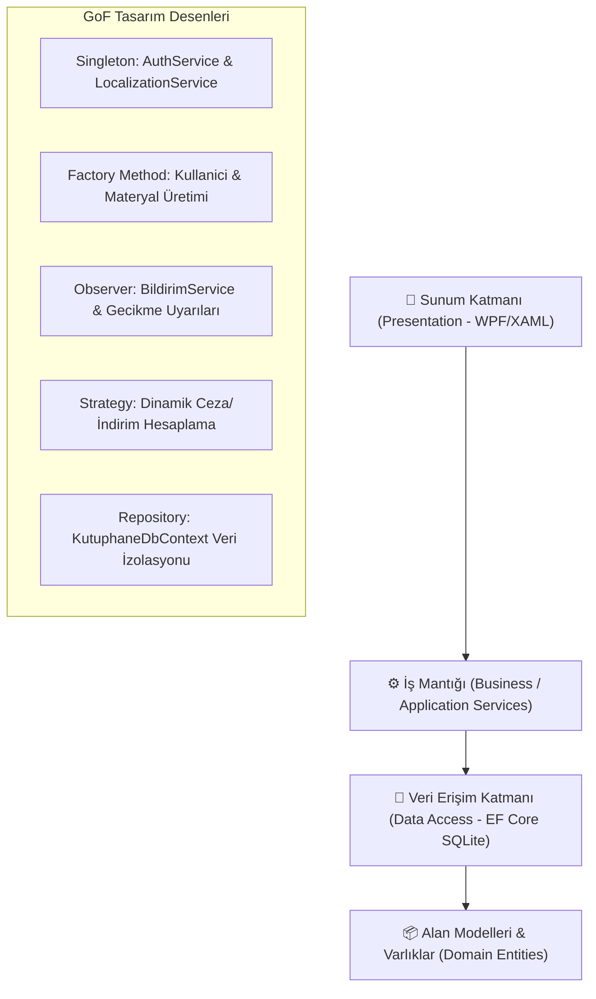

# 🏛️ Kütüphane Yönetim & Akademik Araştırma Sistemi (IRIS Enterprise Suite v3.5)

[](https://dotnet.microsoft.com/)
[](https://en.wikipedia.org/wiki/Multitier_architecture)
[](https://www.sqlite.org/)
[](https://en.wikipedia.org/wiki/Design_Patterns)
[](https://github.com/sudenurozturkk/KutuphaneOtomasyonu)
[]()

**IRIS (Integrated Research & Information System)**, dünya çapındaki araştırma üniversiteleri, enstitüler ve konsorsiyumlar (*Ex Libris Alma / FOLIO standardı*) seviyesinde tasarlanmış, ultra-modernist ve kurumsal masaüstü kütüphane otomasyon sistemidir.

Yazılım Tasarım Mimarisi (Software Architecture) ilkeleri, **Gang of Four (GoF)** desenleri ve temiz kod prensipleri temel alınarak geliştirilmiştir.

---

## 🌟 Öne Çıkan Küresel Yetenekler (World-Class Features)

- 🌐 **Global Çoklu Dil (i18n):** Başlık çubuğundan tek tıkla **İngilizce (EN)** ve **Türkçe (TR)** arayüz geçişi.
- 🎓 **Akademik Tez & Makale Havuzu:** Doktora/Yüksek Lisans tezleri, hakemli dergiler, DOI indeksleri ve açık erişim tam metin indirme.
- 📋 **Otomatik Akademik Alıntı Motoru (Citation Generator):**
  - **APA 7th Edition**
  - **MLA 9th Edition**
  - **BibTeX (LaTeX araştırmacıları için doğrudan kod üretimi)**
- 🚚 **Kampüsler Arası Ödünç Transferi (ILL - Inter-Library Loan):** Merkez, Mühendislik, Tıp ve Sosyal Bilimler kütüphaneleri arasında iç kurye takip kodu (`ILL-2026-TR-...`) ile fiziksel materyal transferi.
- 🪑 **2D İnteraktif Salon Haritası & IoT Telemetrisi:** Sessiz, Bireysel ve Grup alanlarında masa rezervasyonu ve canlı durum rozetleri.
- 💳 **Dijital Cüzdan & RFID Kart:** Otomatik ceza mahsubu, bakiye yükleme ve harcama geçmişi.
- ⚡ **Barkod & ISBN Banko Terminali:** Donanım simülasyonu, anlık log konsolu ve hızlı teslim alma.
- 📊 **Yönetim Analitiği & Raporlama:** Canlı KPI sayaçları, borç analizi ve masaüstüne UTF-8 CSV ihracı.
- 🧩 **Canlı Mimari & UML Müfettişi:** Katman analizi, 5 GoF deseni canlı testi ve garbage collector bellek optimizasyonu.

---

## 🏛️ Mimari Yapı & GoF Tasarım Desenleri

Proje katı **Separation of Concerns (SoC)** ve **Clean Architecture** prensiplerine sadık kalınarak 4 ana katmana ayrılmıştır:



### Uygulanan GoF Desenleri
1. **Singleton Deseni (`AuthService`, `LocalizationService`):** Oturum kimlik doğrulaması ve küresel dil kaynağının tüm pencerelerde tekil yönetimi.
2. **Factory Method Deseni (`KullaniciFactory`):** Öğrenci, Akademisyen ve Personel nesnelerinin farklı yetki ve kota kurallarıyla dinamik üretilmesi.
3. **Observer Deseni (`BildirimService`, `IOduncObserver`):** Kitap teslim tarihi yaklaştığında veya geciktiğinde ilgili üyelere otomatik reaktif bildirim dağıtımı.
4. **Strategy Deseni (`ICezaHesaplamaStratejisi`):** Öğrenci (standart), Akademisyen (muafiyet/indirimli) ve Personel için farklı ceza politikalarının runtime'da enjekte edilmesi.
5. **Repository / Unit of Work Deseni:** SQLite veri işlemlerinin doğrudan UI'a sızmasını önleyerek servis katmanında soyutlanması.

---

## 📋 14 Temel Modül & Yetenek Matrisi

| # | Modül | Açıklama |
|---|---|---|
| 1 | **📊 Genel Bakış (Dashboard)** | Canlı KPI metrikleri, geciken iadeler, salon doluluğu ve hızlı işlem butonları. |
| 2 | **📖 Kitap Kataloğu & Envanter** | Çoklu filtreleme (Kategori, Dil, Stok), ISBN araması ve CSV dışa aktarımı. |
| 3 | **🔄 Ödünç & İade Lojistiği** | Aktif, gecikmiş ve geçmiş işlemler; süre uzatma ve hasar kontrolü. |
| 4 | **👥 Üye Yönetimi** | Öğrenci, Akademisyen ve Personel profilleri, borç durumu ve çift tıkla detay kartı. |
| 5 | **🪑 2D Salon & Masa Haritası** | Sessiz, Bireysel ve Grup alanlarında 20 masa için interaktif rezervasyon ve boşaltma. |
| 6 | **📅 Rezervasyon Kuyruğu** | Tüketen kitaplar için bekleme sırası, sıradan doğrudan ödünce dönüştürme ve iptal. |
| 7 | **⚡ Hızlı Barkod Bankosu** | Barkod/ISBN okutma simülasyonu, canlı terminal log akışı ve hızlı teslimat. |
| 8 | **💳 Akıllı Cüzdan & Üye Kartı** | Bakiye yükleme (₺20, ₺50, ₺100), temassız işlem ve cüzdandan ceza ödeme. |
| 9 | **📱 E-Kitap Okuyucu Hub** | Temiz Kod ve Tasarım Desenleri kitapları, sayfalama, font boyutu ve gece modu. |
| 10 | **📈 Raporlar & Analitik** | Kütüphane metrikleri, aktivite dağılımları ve masaüstüne UTF-8 CSV ihracı. |
| 11 | **⚙️ Sistem Parametreleri** | Ceza tarifeleri, ödünç süre limitleri ve tek tıkla canlı veritabanı yedeği. |
| 12 | **🎓 Akademik Tez & Makale (IRIS)** | Doktora/Y.Lisans tezleri, DOI, açık erişim PDF indirme ve **APA / MLA / BibTeX** alıntı üretici. |
| 13 | **🚚 Kampüs Transferi (ILL)** | 4 üniversite kampüsü arasında kütüphaneler arası kurye ve lojistik takip sistemi. |
| 14 | **🧩 Canlı Mimari & UML (LAB)** | Katman incelemesi, 5 GoF deseni canlı testi ve bellek (GC) optimizasyonu. |

---

## 📂 Proje Dizin Yapısı

```
KutuphaneOtomasyonu/
├── Data/                          # Veritabanı ve Tohumlama
│   ├── KutuphaneDbContext.cs      # EF Core SQLite Bağlantısı & Indexler
│   └── DatabaseSeeder.cs          # 30+ Kitap, 50 Üye, 5 Akademik Tez Tohumu
├── Models/                        # Domain Varlıkları
│   ├── Kitap.cs                   # Kitap entity & durum enumları
│   ├── Uye.cs                     # Üye, rol ve borç modelleri
│   ├── Odunc.cs                   # Ödünç hareketleri ve ceza takibi
│   ├── AkademikVeKampus.cs        # Tez, Makale, DOI, Citation, ILL modelleri
│   ├── DigerModeller.cs           # Rezervasyon, Favori, Bildirim modelleri
│   └── KullaniciVeAyarlar.cs      # Admin, Kütüphaneci ve Parametreler
├── Services/                      # İş Mantığı & GoF Desenleri
│   ├── AuthService.cs             # [Singleton] Oturum yönetimi
│   ├── LocalizationService.cs     # [Singleton] Çoklu dil (TR/EN) servisi
│   ├── KitapService.cs            # Kitap katalog operasyonları
│   ├── OduncService.cs            # Ödünç, iade, süre uzatma ve ceza hesabı
│   ├── AkademikService.cs         # Tez, DOI, Citation ve ILL lojistiği
│   └── DigerServisler.cs          # Bildirim [Observer], Strateji [Strategy]
├── Views/                         # Modernist XAML Arayüzleri
│   ├── LoginWindow.xaml           # Ultra-modern giriş ekranı & Demo butonları
│   ├── MainWindow.xaml            # 260px ferah sidebar menü, TR/EN dil toggle
│   └── Pages/                     # 14 Bağımsız Modül Sayfası & 6 Modal Dialog
│       ├── DashboardPage.xaml     # Yönetici paneli & KPI kartları
│       ├── KitaplarPage.xaml      # Zengin envanter tablosu & filtreler
│       ├── AkademikHubPage.xaml   # Tez arşivi & APA/MLA/BibTeX Citation
│       ├── KampusTransferPage.xaml# ILL Kütüphaneler arası kurye takibi
│       ├── SalonRezervasyonPage.xaml # 2D interaktif masa haritası
│       └── ...                    # Diğer 9 modül ve modal diyaloglar
├── SmokeTester.cs                 # Otomatik Uçtan Uca Doğrulama Motoru
└── KutuphaneOtomasyonu.csproj     # .NET 9.0 Windows WPF Proje Tanımı
```

---

## 🚀 Kurulum & Çalıştırma

### Gereksinimler
- [.NET 9.0 SDK](https://dotnet.microsoft.com/download/dotnet/9.0)
- Windows 10 / 11 (x64)

### Başlatma Adımları
```bash
# 1. Depoyu klonlayın
git clone https://github.com/sudenurozturkk/KutuphaneOtomasyonu.git

# 2. Dizin içine girin
cd KutuphaneOtomasyonu

# 3. Bağımlılıkları derleyin ve uygulamayı başlatın
dotnet run
```

### Varsayılan Giriş Hesapları
| Rol | Kullanıcı Adı | Şifre |
|---|---|---|
| **Sistem Yöneticisi (Admin)** | `admin` | `admin123` |
| **Kütüphaneci (Staff)** | `fatmak` | `123456` |

---

## 🧪 Otomatik Test ve Sağlamlık Doğrulaması

Proje, 14 modülün, 6 modal pencerenin ve tüm menü geçişlerinin UI seviyesinde hatasız çalıştığını test eden yerleşik bir test motoruna sahiptir:

```bash
# Otomatik doğrulamayı çalıştırın:
dotnet run -- --test
```

**Konsol Çıktısı:**
```
=== GENİŞLETİLMİŞ TÜM MODÜLLER TESTİ ===
[PASS] Veritabanı bağlantısı ve Seed (30 kitap, 5 akademik tez, 50 üye, 14 ödünç)
[PASS] Admin girişi başarılı: Ahmet Yıldız
--- 14 SAYFANIN TESTİ ---
[PASS] 1. DashboardPage oluşturuldu
[PASS] 2. KitaplarPage oluşturuldu
[PASS] 3. OdunclerPage oluşturuldu
[PASS] 4. UyelerPage oluşturuldu
[PASS] 5. SalonRezervasyonPage oluşturuldu
[PASS] 6. RezervasyonlarPage oluşturuldu
[PASS] 7. BarkodBankoPage oluşturuldu
[PASS] 8. CuzdanPage oluşturuldu
[PASS] 9. EKitapPage oluşturuldu
[PASS] 10. RaporlarPage oluşturuldu
[PASS] 11. AyarlarPage oluşturuldu
[PASS] 12. MimariUmlPage oluşturuldu
[PASS] 13. AkademikHubPage oluşturuldu
[PASS] 14. KampusTransferPage oluşturuldu
--- 6 DİYALOG PENCERESİNİN TESTİ ---
[PASS] KitapEkleDialog, UyeEkleDialog, OduncVerDialog, IadeDialog, KitapDetayDialog, UyeDetayDialog
--- MENÜ NAVİGASYONLARI TESTİ ---
[PASS] MainWindow 14 sayfa rotasının tümü %100 BAŞARILI.
```

---

## 📄 Lisans
Bu proje MIT Lisansı altında açık kaynaklı olarak sunulmaktadır. Üniversiteler, araştırma enstitüleri ve eğitim kurumları serbestçe genişletebilir ve kullanabilir.
