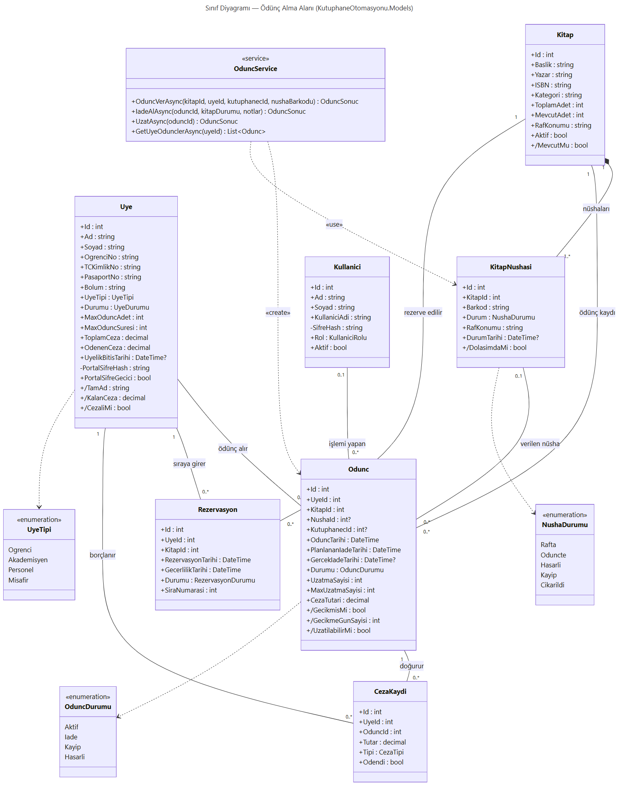
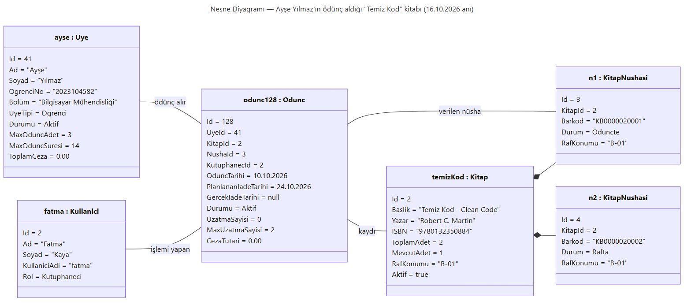
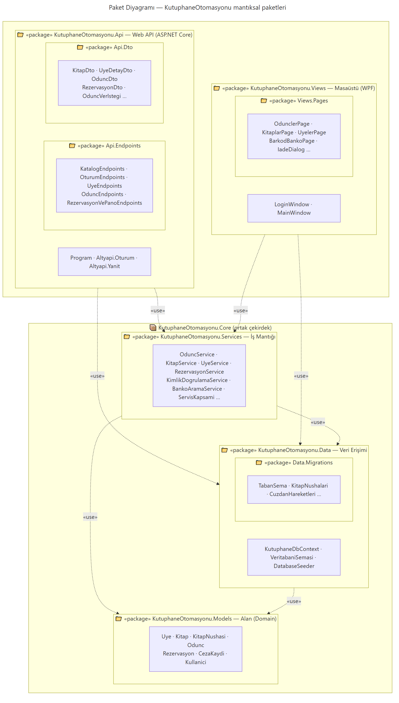
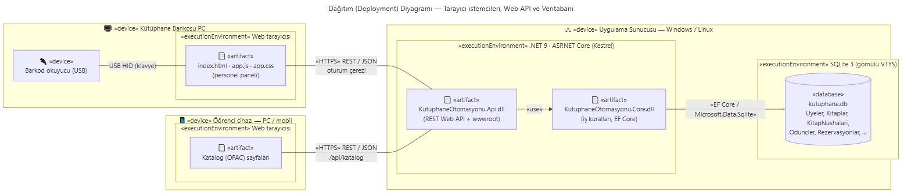

# UML Diyagramları

Bu klasördeki diyagramlar projenin gerçek kodundan (`Models/`, `Services/`, `Data/`, `Views/`) çıkarılmıştır.
Her diyagramın kaynağı bir Mermaid dosyasıdır (`.mmd`); `.png` ve `.svg` dosyaları bu kaynaktan üretilmiştir.

| # | Ödev maddesi | Dosya |
|---|---|---|
| 1 | En az dört sınıflı sınıf diyagramı, ilişkiler ve çokluklar | [1-sinif-diyagrami](1-sinif-diyagrami.png) |
| 2 | Bir öğrencinin ödünç aldığı kitaba ait nesne diyagramı | [2-nesne-diyagrami](2-nesne-diyagrami.png) |
| 3 | En az 3 mantıksal paket (5 paket) | [3-paket-diyagrami](3-paket-diyagrami.png) |
| 4 | Web API ve veritabanı içeren dağıtım diyagramı | [4-dagitim-diyagrami](4-dagitim-diyagrami.png) |

---

## 1. Sınıf Diyagramı



Ödünç alma alanının 7 sınıfı (`Uye`, `Kitap`, `KitapNushasi`, `Odunc`, `Rezervasyon`, `CezaKaydi`, `Kullanici`),
ödünç işlemlerini yöneten `OduncService` ve 3 numaralandırma (enum) gösterilmiştir. `/` ile başlayan nitelikler
**türetilmiş** niteliklerdir (veritabanında tutulmaz, diğer alanlardan hesaplanır; örn. `KalanCeza = ToplamCeza - OdenenCeza`).

| İlişki | Tür | Çokluk | Anlamı |
|---|---|---|---|
| Kitap — KitapNushasi | Kompozisyon (◆) | 1 — 1..* | Her kitabın en az bir fiziksel nüshası vardır; nüsha kitabı olmadan var olamaz. |
| Uye — Odunc | İlişki | 1 — 0..* | Bir üye hiç ödünç almamış olabilir ya da birçok ödünç kaydı olabilir. |
| Kitap — Odunc | İlişki | 1 — 0..* | Bir kitabın ödünç geçmişinde birden çok kayıt bulunur. |
| KitapNushasi — Odunc | İlişki | 0..1 — 0..* | Ödünç belirli bir nüshaya bağlıdır (eski kayıtlarda boş olabilir); bir nüsha zaman içinde birçok kez ödünç verilir. |
| Kullanici — Odunc | İlişki | 0..1 — 0..* | İşlemi yapan kütüphaneci kaydedilir. |
| Uye — Rezervasyon, Kitap — Rezervasyon | İlişki | 1 — 0..* | Bir üye birden çok kitap için sıraya girebilir; bir kitabın birden çok bekleyeni olabilir. |
| Odunc — CezaKaydi | İlişki | 1 — 0..* | Gecikme, hasar veya kayıp bir ödünçte ceza doğurabilir. |
| Uye — CezaKaydi | İlişki | 1 — 0..* | Cezalar üyenin borcuna yazılır. |
| OduncService ⇢ Odunc / KitapNushasi | Bağımlılık | — | Servis ödünç kaydını oluşturur ve nüsha durumunu günceller. |

## 2. Nesne Diyagramı



Bilgisayar Mühendisliği öğrencisi **Ayşe Yılmaz**'ın, kütüphaneci **Fatma Kaya** aracılığıyla 10.10.2026'da
ödünç aldığı *Temiz Kod* kitabının 16.10.2026 tarihindeki anlık görüntüsüdür:

- `odunc128` aktiftir; iade tarihi 14 günlük öğrenci süresine göre 24.10.2026'dır ve henüz uzatılmamıştır.
- Kitabın iki nüshası vardır: `n1` (KB0000020001) Ayşe'dedir, `n2` raftadır; bu yüzden `MevcutAdet = 1`.
- Nesne değerleri sınıf diyagramındaki tiplerle ve ilişkilerle birebir uyumludur (örn. `odunc128.NushaId = n1.Id = 3`).

## 3. Paket Diyagramı



Kod, C# isim alanlarına (namespace) karşılık gelen 5 mantıksal pakete ve 4 alt pakete ayrılmıştır. `Services`, `Data` ve
`Models` arayüzden bağımsız **KutuphaneOtomasyonu.Core** kütüphanesindedir; iki sunum paketi bu çekirdeği paylaşır:

| Paket | Sorumluluk |
|---|---|
| `KutuphaneOtomasyonu.Api` (+ `Api.Endpoints`, `Api.Dto`) | Web API: HTTP uç noktaları, oturum ve yetki, API veri modelleri, tarayıcı arayüzü |
| `KutuphaneOtomasyonu.Views` (+ `Views.Pages`) | Masaüstü (WPF) arayüzü: pencereler, sayfalar ve diyaloglar |
| `KutuphaneOtomasyonu.Services` | İş mantığı: ödünç/iade kuralları, rezervasyon kuyruğu, kimlik doğrulama |
| `KutuphaneOtomasyonu.Data` (+ `Data.Migrations`) | Veri erişimi: EF Core `DbContext`, şema migration'ları, demo verisi |
| `KutuphaneOtomasyonu.Models` | Alan (domain) sınıfları: `Uye`, `Kitap`, `Odunc` … |

Bağımlılıklar yukarıdan aşağıya doğrudur: `Models` hiçbir pakete bağımlı değildir, çekirdek paketler `Api` veya `Views`'i
bilmez. Bu sayede aynı iş kuralları hem web'de hem masaüstünde birebir aynı çalışır.

## 4. Dağıtım Diyagramı



Sistem çevrimiçi çalışır; istemciler yalnızca bir web tarayıcısıdır:

- **Kütüphane bankosu PC:** tarayıcıda personel paneli (giriş, banko, ödünçler, üyeler, rezervasyonlar). USB barkod
  okuyucu klavye gibi çalışır ve barkodu doğrudan forma yazar.
- **Öğrenci cihazı (PC veya mobil):** tarayıcıdan katalog araması ve kitabın rafta olup olmadığı (giriş gerekmez).
- **Uygulama sunucusu:** .NET 9 / ASP.NET Core (Kestrel) üzerinde `KutuphaneOtomasyonu.Api.dll` çalışır; REST/JSON uç
  noktalarını ve tarayıcı arayüzü dosyalarını (`wwwroot`) HTTPS üzerinden sunar. İş kuralları `KutuphaneOtomasyonu.Core.dll`
  içindedir.
- **Veritabanı:** `kutuphane.db`, EF Core ve Microsoft.Data.Sqlite ile erişilen SQLite veritabanıdır. SQLite gömülü bir
  VTYS olduğundan ayrı bir sunucu süreci yoktur; veritabanı dosyası uygulama sunucusunda durur.

İsteğe bağlı olarak WPF masaüstü uygulaması da sunucu makinesinde aynı veritabanı dosyasıyla çalışabilir (diyagramda
gösterilmemiştir). Ayrıntılar ve çalıştırma komutları: ana [README](../../README.md) → "Çevrimiçi Kullanım".

---

## Diyagramları yeniden üretmek

GitHub `.mmd` dosyalarını doğrudan göstermez; görseller [mermaid-cli](https://github.com/mermaid-js/mermaid-cli) ile üretilir:

```bash
npx -p @mermaid-js/mermaid-cli@11.4.2 mmdc -i 1-sinif-diyagrami.mmd -o 1-sinif-diyagrami.png -b white -s 2
```

Kaynaklar [mermaid.live](https://mermaid.live) üzerinde de düzenlenebilir.
